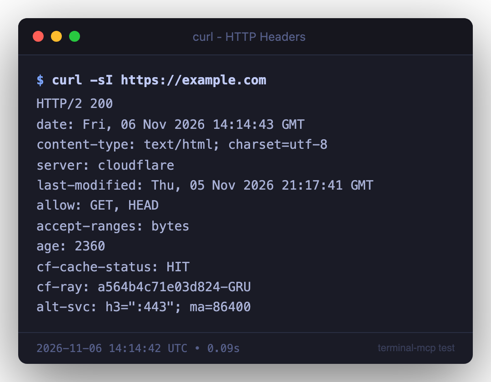

# terminal-mcp

MCP server that executes shell commands and captures terminal output as styled PNG screenshots — perfect for pentest reports, documentation, and any workflow where you need professional-looking terminal captures.

Works with any MCP-compatible client: **Claude Code**, **OpenAI Codex**, **Antigravity**, **Cursor**, **Windsurf**, **Cline**, **Continue**, and more.

## Features

- **Execute & capture**: Run commands with full ANSI color preservation
- **Terminal-styled screenshots**: Renders output as PNG with macOS window chrome, proper colors, and metadata
- **7 built-in themes**: Tokyo Night, Dracula, Monokai, Catppuccin, Hacker, macOS, Kali
- **Report-ready**: Watermarks, timestamps, exit codes, custom titles
- **Full ANSI support**: 16 colors, 256-color palette, and 24-bit truecolor
- **Cross-platform**: macOS and Linux support
- **Session capture management**: List, re-render, and manage captures

## Screenshot Examples



## Installation

### Quick Setup (Recommended)

```bash
git clone https://github.com/JoasASantos/terminal-mcp.git
cd terminal-mcp
chmod +x setup.sh
./setup.sh
```

The setup script handles everything: dependency installation, build, and MCP client registration.

### Manual Setup

```bash
git clone https://github.com/JoasASantos/terminal-mcp.git
cd terminal-mcp
npm install
npm run build
```

### Linux Prerequisites

On Linux, Puppeteer requires some system libraries for Chromium:

**Debian/Ubuntu:**
```bash
sudo apt-get install -y \
  libnss3 libatk1.0-0 libatk-bridge2.0-0 libcups2 \
  libdrm2 libxkbcommon0 libxcomposite1 libxdamage1 \
  libxrandr2 libgbm1 libpango-1.0-0 libcairo2 libasound2
```

**Fedora/RHEL:**
```bash
sudo dnf install -y \
  nss atk at-spi2-atk cups-libs libdrm libxkbcommon \
  libXcomposite libXdamage libXrandr mesa-libgbm pango cairo alsa-lib
```

**Arch Linux:**
```bash
sudo pacman -S nss atk at-spi2-atk cups libdrm libxkbcommon \
  libxcomposite libxdamage libxrandr mesa pango cairo alsa-lib
```

## Client Configuration

### Claude Code

**Automatic (via setup.sh):**
```bash
./setup.sh
# Restart Claude Code after setup
```

**Manual (via CLI):**
```bash
claude mcp add terminal-mcp --scope user -e TERMINAL_MCP_DIR="$HOME/terminal-screenshots" -- node /path/to/terminal-mcp/dist/index.js
```

### OpenAI Codex

Add to your Codex MCP configuration:
```json
{
  "mcpServers": {
    "terminal-mcp": {
      "command": "node",
      "args": ["/path/to/terminal-mcp/dist/index.js"],
      "env": {
        "TERMINAL_MCP_DIR": "/path/to/screenshots"
      }
    }
  }
}
```

### Cursor

Add to `.cursor/mcp.json` in your project or `~/.cursor/mcp.json` globally:
```json
{
  "mcpServers": {
    "terminal-mcp": {
      "command": "node",
      "args": ["/path/to/terminal-mcp/dist/index.js"],
      "env": {
        "TERMINAL_MCP_DIR": "/path/to/screenshots"
      }
    }
  }
}
```

### Windsurf

Add to your Windsurf MCP settings (`~/.windsurf/mcp.json`):
```json
{
  "mcpServers": {
    "terminal-mcp": {
      "command": "node",
      "args": ["/path/to/terminal-mcp/dist/index.js"],
      "env": {
        "TERMINAL_MCP_DIR": "/path/to/screenshots"
      }
    }
  }
}
```

### Cline (VS Code)

Add to Cline's MCP server settings in VS Code:
```json
{
  "mcpServers": {
    "terminal-mcp": {
      "command": "node",
      "args": ["/path/to/terminal-mcp/dist/index.js"],
      "env": {
        "TERMINAL_MCP_DIR": "/path/to/screenshots"
      }
    }
  }
}
```

### Continue

Add to `~/.continue/config.json`:
```json
{
  "experimental": {
    "mcpServers": {
      "terminal-mcp": {
        "command": "node",
        "args": ["/path/to/terminal-mcp/dist/index.js"],
        "env": {
          "TERMINAL_MCP_DIR": "/path/to/screenshots"
        }
      }
    }
  }
}
```

### Antigravity

Add to your Antigravity MCP configuration:
```json
{
  "mcpServers": {
    "terminal-mcp": {
      "command": "node",
      "args": ["/path/to/terminal-mcp/dist/index.js"],
      "env": {
        "TERMINAL_MCP_DIR": "/path/to/screenshots"
      }
    }
  }
}
```

### Generic MCP Client

Any client supporting the [Model Context Protocol](https://modelcontextprotocol.io/) can use terminal-mcp. The server communicates over **stdio** using JSON-RPC. Configure it with:

- **Command:** `node`
- **Args:** `["/path/to/terminal-mcp/dist/index.js"]`
- **Env (optional):** `TERMINAL_MCP_DIR` — directory for saved screenshots

## Tools

| Tool | Description |
|------|-------------|
| `terminal_exec` | Execute a command and capture output with ANSI colors |
| `terminal_screenshot` | Render a captured output as a terminal-styled PNG |
| `terminal_exec_screenshot` | Execute + screenshot in one step |
| `terminal_screenshot_text` | Render arbitrary text as a terminal PNG |
| `terminal_list_captures` | List all captures in the current session |
| `terminal_list_screenshots` | List saved PNG files |
| `terminal_themes` | List available themes |

## Themes

- **tokyonight** (default) — Dark blue, clean and modern
- **dracula** — Classic purple-accented dark theme
- **monokai** — Warm dark theme with vibrant colors
- **catppuccin** — Soft pastel dark theme
- **hacker** — Green-on-black matrix style
- **macos** — Native macOS Terminal.app dark theme
- **kali** — Kali Linux terminal colors

## Screenshot Options

| Option | Type | Default | Description |
|--------|------|---------|-------------|
| `theme` | string | `tokyonight` | Color theme |
| `show_chrome` | boolean | `true` | macOS window chrome with traffic lights |
| `font_size` | number | `14` | Font size in pixels |
| `title` | string | command name | Window title bar text |
| `prompt` | string | `$ ` | Shell prompt prefix |
| `show_timestamp` | boolean | `true` | Show timestamp in footer |
| `watermark` | string | — | Watermark text (bottom-right) |
| `save_path` | string | auto | Full path for the output PNG |

## Usage Examples

### Basic command screenshot
```
terminal_exec_screenshot({ command: "nmap -sV target.com", theme: "hacker" })
```

### Pentest report with watermark
```
terminal_exec_screenshot({
  command: "nikto -h https://target.com",
  theme: "tokyonight",
  watermark: "CONFIDENTIAL - Pentest Report 2024",
  title: "Nikto Web Scanner"
})
```

### Screenshot arbitrary text
```
terminal_screenshot_text({
  text: "Finding: SQL Injection in /api/users\nSeverity: Critical\nCVSS: 9.8",
  title: "Vulnerability Report",
  theme: "dracula"
})
```

## Environment Variables

| Variable | Default | Description |
|----------|---------|-------------|
| `TERMINAL_MCP_DIR` | `~/terminal-screenshots` | Directory for saved screenshots |

## Requirements

- Node.js 18+
- Puppeteer (bundled — downloads Chromium on first run)
- On Linux: system libraries for headless Chromium (see [Linux Prerequisites](#linux-prerequisites))

## License

[MIT](LICENSE)
